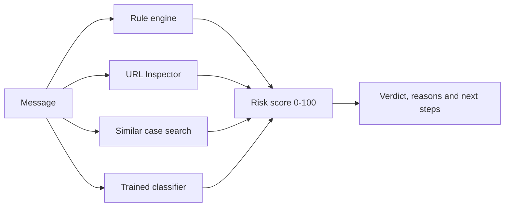

# Scam Checker

A senior-friendly chatbot, in English and Traditional Chinese, that checks suspicious messages. Paste an SMS or WhatsApp message and it gives a low, medium or high risk verdict, explains why in plain language, and tells the user what to do next, including who to call in Hong Kong.

Built for COMP4431 (Artificial Intelligence) at The Hong Kong Polytechnic University.

> **This is a student project and a guide only.** It can miss scams and can wrongly flag genuine messages. If in doubt in Hong Kong, call the Anti-Scam Helpline on **18222**.

## Contents

- [Features](#features)
- [How it works](#how-it-works)
- [Quick start](#quick-start)
- [Ways to run it](#ways-to-run-it)
- [Project layout](#project-layout)
- [Changing the wording](#changing-the-wording)
- [Training the models](#training-the-models)
- [Deploying to Streamlit](#deploying-to-streamlit)
- [Configuration](#configuration)
- [API](#api)
- [Testing](#testing)
- [Evaluation](#evaluation)
- [Limitations](#limitations)
- [Troubleshooting](#troubleshooting)
- [Team](#team)
- [Credits](#credits)

## Features

| Feature | Description | Where to find it |
|---|---|---|
| Elderly-friendly chat | Large text, plain words, one question at a time, a one-tap call button, and a switch between English and Traditional Chinese | `streamlit_app.py`, `frontend/` |
| Explainable rule engine | 28 red-flag rules and 11 compound rules, using forward chaining | `backend/rules/` |
| Text clean-up | Removes invisible characters hidden inside words, turns look-alike letters into plain ones, and converts Simplified Chinese to Traditional | `backend/normalize.py` |
| URL Inspector | Detects lookalike domains, look-alike characters, punycode, IP addresses and short links, without opening them | `backend/matching/url_inspector.py` |
| Similar case search | Compares a message with known scam types using TF-IDF | `backend/matching/similarity.py` |
| Trained classifier | TF-IDF and logistic regression, trained on the SMS Spam Collection. A separate Chinese model can be trained from your own data | `ml/train.py`, `backend/classifier.py` |
| Genetic algorithm | A self-written GA tunes the rule weights against labelled data | `ga/tune.py` |
| Follow-up and action plan | Asks what has already happened, then gives the matching steps and an incident summary | `backend/dialogue.py` |
| Local LLM explanations (optional) | Rewrites the explanation with Ollama. It cannot change the score | `backend/llm.py` |
| Scam Gym | Practise spotting a fictional scam and get a score | `backend/gym.py` |
| Read-aloud | Speaks the verdict using Windows voices | `frontend/speech.py` |
| Call recording analysis (optional) | Speech-to-text with faster-whisper, then the same analysis | `backend/stt.py` |

## How it works



```text
risk_score = sum(rule weights) + w_match × similarity + w_url × url_flag + w_ml × classifier_probability
```

The score is clamped to 0–100. Scores of 70 or more are high risk, and 40 to 69 are medium risk. The rule weights are tuned by the genetic algorithm.

## Quick start

You need [Python](https://www.python.org/downloads/) **3.12 or newer** (tested on 3.12, 3.13 and 3.14) and [Git](https://git-scm.com/downloads). The trained model is included, so you do not have to train anything to run the app.

**1. Download the code**

```bash
git clone https://github.com/<your-username>/scam-checker.git
cd scam-checker
```

Or choose **Code → Download ZIP** on GitHub, unzip it, and open a terminal in that folder.

**2. Create a virtual environment**

Windows (PowerShell):

```powershell
python -m venv .venv
.\.venv\Scripts\Activate.ps1
```

macOS or Linux:

```bash
python3 -m venv .venv
source .venv/bin/activate
```

**3. Install the packages**

```bash
python -m pip install -r requirements.txt
```

**4. Start the app**

```bash
python -m streamlit run streamlit_app.py
```

Open <http://localhost:8501>. Press **Ctrl+C** in the terminal to stop it.

New to this? [docs/INSTALL.md](docs/INSTALL.md) is a step-by-step guide in Traditional Chinese.

## Ways to run it

| Goal | Command | Open |
|---|---|---|
| Main app | `python -m streamlit run streamlit_app.py` | <http://localhost:8501> |
| Terminal demo | `python demo.py` | In the terminal |
| Terminal demo, every scene | `python demo.py --auto --no-llm` | In the terminal |
| API and web demo | `python -m uvicorn backend.main:app --port 8000` | <http://127.0.0.1:8000> |
| API documentation | Same as above | <http://127.0.0.1:8000/docs> |

The web demo shows features the main app does not, such as highlighted red flags and Scam Gym.

**Optional: local LLM explanations.** Install [Ollama](https://ollama.com), then run the command below. They apply to the terminal demo and the web demo. The Streamlit app does not use the LLM, because it must answer within 3 seconds.

```bash
ollama pull qwen2.5:7b
```

**Optional: call recordings.** faster-whisper is needed for `python demo.py --audio call.wav` and for `POST /analyze-audio`. This path has not been tested yet.

```bash
python -m pip install -r requirements-optional.txt
```

## Project layout

```text
scam-checker/
├── streamlit_app.py           Main app. Streamlit Cloud starts here
├── demo.py                    Terminal demo for presentations
├── requirements.txt           Packages needed to run
├── requirements-dev.txt       Adds the test tools
├── .streamlit/config.toml     Colours, font size
├── frontend/
│   ├── response_templates.py  WORDING: verdicts, buttons, examples
│   ├── intents.py             WORDING: questions the bot can answer
│   ├── analyzer.py            Connects the app to the detector
│   ├── speech.py, speech.ps1  Read-aloud
│   └── web_demo/index.html    Basic web interface served by the API
├── backend/
│   ├── wording.py             WORDING: all backend text
│   ├── service.py             Entry point used by the app and the API
│   ├── main.py                FastAPI endpoints
│   ├── pipeline.py            Runs one message through the detector
│   ├── scoring.py             Risk score formula
│   ├── dialogue.py            Follow-up questions and action plans
│   ├── patterns.py            Rule-to-reason mapping for the app
│   ├── classifier.py          Loads the trained model
│   ├── llm.py, stt.py, gym.py Optional LLM, speech-to-text, Scam Gym
│   ├── rules/                 Detection patterns, engine, tuned weights
│   ├── matching/              URL Inspector and similar case search
│   └── models/                The trained classifier
├── ml/train.py                Trains the classifier
├── ga/                        Genetic algorithm
├── evaluation/                Evaluation script and results
├── data/                      Datasets and known scam cases
├── tests/                     Automated tests
└── docs/                      Guides and team documents
```

## Changing the wording

| What you want to change | File |
|---|---|
| Anything on the Streamlit screen | `frontend/response_templates.py` |
| Questions the chatbot can answer | `frontend/intents.py` |
| Explanations, follow-ups, action plans, rule reasons, Scam Gym scripts | `backend/wording.py` |

See [docs/EDITING_WORDING.md](docs/EDITING_WORDING.md) for a line-by-line guide (Traditional Chinese).

## Training the models

Run these from the project folder, in this order:

```bash
python -m ml.train
python -m ga.tune
python -m evaluation.run_eval
```

| Command | What it does | What it writes |
|---|---|---|
| `python -m ml.train` | Trains the classifier | `backend/models/sms_tfidf_lr.joblib`, `evaluation/results/classifier_metrics.json` |
| `python -m ga.tune` | Tunes the rule weights, then the classifier weight | `backend/rules/weights_tuned.json`, `evaluation/results/ga_history.json` |
| `python -m evaluation.run_eval` | Compares every method | `evaluation/results/metrics.json`, `evaluation/results/report.md` |

To collect real messages for testing and training, see [docs/DATA_COLLECTION.md](docs/DATA_COLLECTION.md).

Add your own English messages with `python -m ml.train --extra my_messages.tsv`. To train the Chinese model, fill in `data/zh_training.csv`, then run `python -m ml.train --language zh`, followed by the other two commands. See [docs/TRAINING.md](docs/TRAINING.md) for details (Traditional Chinese).

## Deploying to Streamlit

The detector runs inside the Streamlit app, so no separate server is needed.

1. Upload this repository to GitHub.
2. At [share.streamlit.io](https://share.streamlit.io), choose **Create app**.
3. Select the repository, branch `main`, and main file `streamlit_app.py`.
4. Open **Advanced settings** and choose Python 3.12 or newer.
5. Choose **Deploy**.

Read-aloud uses Windows voices, so it is not available on Streamlit Cloud. The full guide is in [docs/INSTALL.md](docs/INSTALL.md).

## Configuration

Set these as environment variables, or as root-level entries in Streamlit Secrets.

| Variable | Default | Meaning |
|---|---|---|
| `SCAM_API_URL` | empty | Call a separate API instead of the built-in detector, for example `http://127.0.0.1:8000/analyze` |
| `LLM_ENABLED` | `1` | Set to `0` to turn off LLM explanations |
| `OLLAMA_URL` | `http://127.0.0.1:11434` | Address of Ollama |
| `OLLAMA_MODEL` | `qwen2.5:7b` | Model name. Try `qwen2.5:3b` on a slow computer |
| `OLLAMA_TIMEOUT_S` | `30` | Seconds to wait for the LLM |
| `EXPAND_SHORT_URLS` | `0` | Set to `1` to read the redirect header of known short links. The destination page is never loaded |
| `WHISPER_MODEL` | `small` | faster-whisper model size |

## API

```bash
curl -X POST http://127.0.0.1:8000/analyze -H "Content-Type: application/json" -d "{\"message\":\"Your account will be suspended, verify now\"}"
```

| Endpoint | Purpose |
|---|---|
| `POST /analyze` | Check one message. Keeps nothing unless a `session_id` is sent |
| `POST /chat` | Conversation with follow-up questions |
| `POST /analyze-audio` | Upload a recording (`multipart`, field `file`) |
| `POST /gym/start`, `POST /gym/reply` | Scam Gym |
| `POST /mock/analyze` | Fixed response for interface work |
| `GET /health` | Status of the LLM and classifier |

The response format is defined in [docs/API_CONTRACT.md](docs/API_CONTRACT.md).

## Testing

```bash
python -m pip install -r requirements-dev.txt
python -m pytest
```

## Evaluation

Five-fold cross-validation on 100 labelled messages. A message counts as flagged at a score of 40 or more.

| Method | Precision | Recall | F1 |
|---|---|---|---|
| Classifier only | 0.625 | 0.20 | 0.303 |
| Rules only | 1.0 | 0.60 | 0.75 |
| Hybrid, hand-set weights | 1.0 | 0.66 | 0.795 |
| Hybrid, GA weights | 0.976 | 0.82 | 0.891 |
| Hybrid, GA weights, classifier | 0.953 | 0.82 | 0.882 |

On its own dataset, the classifier reaches F1 0.939 for spam versus legitimate messages. Spam is not the same as scams, so it transfers poorly: the GA currently gives it a weight of 0, so it does not change any score. It stays in the project as a measured baseline.

> **These figures do not estimate real-world accuracy.** The labelled set is synthetic, written by the author of the rules, and the rules were adjusted after seeing test results.

On six real Chinese scam messages collected by the team, the detector first flagged only one. After adding text clean-up and new rules it flags all six. Those rules were written with the same six messages, so this shows the gaps were closed, not how well it detects new scams.

**Real messages the rules have never seen** (questionnaire, November 2026): the detector flagged 16 of 35 real scams whose wording it had not seen (46%), and 4 of the 11 in the held-out test set. Most misses were fake subscription charges, fake courier calls, tech-support calls and "neighbour" chat openers. After adding rules designed only from the training messages, and tuning the GA on those messages plus the synthetic set, it flags **10 of the 11 held-out messages (91%)**. The test set is small, has no normal messages, and its wording was visible while the rules were written, so treat this as an encouraging sign rather than a measured accuracy.

On 10 real normal messages (bills, one-time passwords, a booking reminder and a courier notice), 1 is wrongly flagged: a genuine SF Express pickup SMS with a link. SF Express Hong Kong no longer sends pickup links by SMS, so a warning there is the safer outcome. These normal messages are training data, so this figure is indicative only. Run `python -m evaluation.real_test` to measure the held-out set in `data/real_test.csv`. It has no normal messages yet, so false alarms cannot be measured on real data.

Full results are in `evaluation/results/report.md`.

## Limitations

- The labelled test set is synthetic. Real scam messages are needed for a meaningful accuracy figure.
- Simplified Chinese is converted with OpenCC character mapping, which can occasionally pick the wrong Traditional character.
- The included classifier only understands English, and was trained on mostly UK marketing spam. The Chinese model needs training data before it can be used.
- Scams with no obvious keywords, such as a casual request for money from a "friend", are often missed.
- The URL Inspector only knows a short list of official domains, in `data/official_domains.json`.
- The sources in `data/scam_cases.json` are placeholders.

## Troubleshooting

| Problem | Fix |
|---|---|
| `python` is not recognised | Install Python and tick **Add python.exe to PATH**, then open a new terminal |
| PowerShell refuses to activate the environment | Run `Set-ExecutionPolicy -Scope Process -ExecutionPolicy Bypass`, then activate again |
| `No matching distribution found for numpy` | Your Python is older than 3.12 |
| `ModuleNotFoundError` | The virtual environment is not active, or step 3 was skipped |
| Port already in use | Add `--server.port 8502` to the Streamlit command |
| `classifier_ready` is `false` in `/health` | Run `python -m ml.train` |
| Read-aloud is unavailable | It only works on Windows. Chinese also needs a Windows Chinese voice, added in Settings under Time & language → Speech |

## Team

| Student ID | Name | Role |
|---|---|---|
| TODO | TODO | Database and matching |
| TODO | TODO | Scoring and backend |
| TODO | TODO | Interface and voice |

## Credits

The classifier uses the [SMS Spam Collection](http://www.dt.fee.unicamp.br/~tiago/smsspamcollection/) by Tiago A. Almeida and José María Gómez Hidalgo. See T. A. Almeida, J. M. Gómez Hidalgo and A. Yamakami, "Contributions to the Study of SMS Spam Filtering: New Collection and Results", *DocEng 2011*. Licence terms are in `data/sms_spam/readme`.
