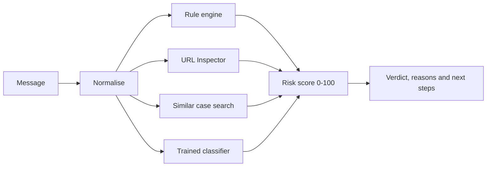

# Scam Checker

COMP4431 Artificial Intelligence, Group 19, The Hong Kong Polytechnic University, November 2026

A chatbot for older users. It checks suspicious messages in English and Traditional Chinese, returns a risk level with the reasons in plain language, and says what to do next, including the Hong Kong anti-scam hotline.

> **This is a student project and a guide only.** It can miss scams and can wrongly flag genuine messages. If in doubt in Hong Kong, call the Anti-Scam Helpline on **18222**.

| | |
|---|---|
| **Open the app** | **[comp4431grp19.streamlit.app](https://comp4431grp19.streamlit.app/)** |
| Local | `python -m streamlit run streamlit_app.py`, then <http://localhost:8501> |
| Slides | [Scam_Checker_Group19.pptx](docs/presentation/Scam_Checker_Group19.pptx) |
| Demo script | [docs/DEMO_SCRIPT.md](docs/DEMO_SCRIPT.md) |
| Stack | Python 3.12+, Streamlit, scikit-learn, FastAPI |

[](https://comp4431grp19.streamlit.app/)

<!-- Screenshot: capture the English verdict screen and the 繁體中文 screen,
     save them as docs/images/app-en.png and docs/images/app-zh.png, then add:
        -->

## Contents

- [Features](#features)
- [Status](#status)
- [How it works](#how-it-works)
- [Quick start](#quick-start)
- [Ways to run it](#ways-to-run-it)
- [Project layout](#project-layout)
- [Deploying](#deploying)
- [Configuration](#configuration)
- [API](#api)
- [Testing](#testing)
- [Changing the wording](#changing-the-wording)
- [Training the models](#training-the-models)
- [Evaluation](#evaluation)
- [Limitations](#limitations)
- [Troubleshooting](#troubleshooting)
- [Team](#team)
- [Licence and credits](#licence-and-credits)

## Features

The app opens as a chat window. The bot greets the user and offers to check a message or book a consultation.

| Feature | What it does |
|---|---|
| Chat | Large text, one question at a time. English and 繁體中文 can be switched mid-conversation without losing it |
| Verdict | Low, medium or high risk, three reasons, three next steps |
| Call button | Dials 18222 in one tap |
| Rule engine | 28 red-flag rules, 3 mitigating and 14 compound, run by forward chaining. A score can be traced back to the rules that fired |
| Text clean-up | Strips zero-width characters from inside words, maps look-alike letters, converts Simplified Chinese to Traditional |
| URL Inspector | Flags look-alike domains, homoglyphs, punycode, raw IPs and short links. Links are never opened |
| Similar cases | TF-IDF comparison against known scam types |
| Follow-up | Asks what already happened, then gives the matching steps and a summary of the incident |
| Booking | Demo. Pick a day and a time by button or by typing `2pm` or `下午兩點`. Taken slots are refused |

The optional parts are the classifier, the genetic algorithm, Ollama explanations, read-aloud, Scam Gym and call transcription. Each is covered below.

## Status

| Part | State |
|---|---|
| Rules, URL Inspector, normalisation, scoring | Working. This is what produces the score |
| Classifier | Trained model, kept as a baseline. Its weight is 1, so it adds at most 1 point |
| LLM explanations | Optional. Terminal and web demo only. It cannot change the score |
| Call recording | Written, not tested |
| Booking | Demo. Held in memory, shared by everyone using the app, cleared on restart |
| Evaluation | 100 synthetic messages for cross-validation, and 17 held-out real scams |

## How it works



```text
risk_score = sum(rule weights) + w_match × similarity + w_url × url_flag + w_ml × classifier_probability
```

The score is clamped to 0–100. Scores of 70 or more are high risk, 40 to 69 are medium risk, below 40 is low risk. The rule weights are tuned by the genetic algorithm in `ga/`.

## Quick start

Python 3.12 or newer is required, plus [Git](https://git-scm.com/downloads). Tested on 3.12, 3.13 and 3.14. The trained model is committed, so nothing has to be trained before the app runs.

**1. Get the code**

```bash
git clone https://github.com/NCLJovi/COMP4431Grp19.git
cd COMP4431Grp19
```

A ZIP can also be downloaded from GitHub. Unzip it and open a terminal in that folder.

**2. Create a virtual environment**

Windows (PowerShell):

```powershell
python -m venv .venv
.\.venv\Scripts\Activate.ps1
```

macOS or Linux:

```bash
python3 -m venv .venv
source .venv/bin/activate
```

**3. Install the packages**

```bash
python -m pip install -r requirements.txt
```

**4. Start the app**

```bash
python -m streamlit run streamlit_app.py
```

Open <http://localhost:8501>. Press **Ctrl+C** in the terminal to stop it.

A step-by-step guide in Traditional Chinese is in [docs/INSTALL.md](docs/INSTALL.md).

## Ways to run it

| Goal | Command | Open |
|---|---|---|
| Main app | `python -m streamlit run streamlit_app.py` | <http://localhost:8501> |
| Terminal demo | `python demo.py` | In the terminal |
| Terminal demo, every scene | `python demo.py --auto --no-llm` | In the terminal |
| API and web demo | `python -m uvicorn backend.main:app --port 8000` | <http://127.0.0.1:8000> |
| API documentation | Same as above | <http://127.0.0.1:8000/docs> |

The web demo has a few things the main app does not, such as highlighted red flags and Scam Gym.

**Optional: local LLM explanations.** Install [Ollama](https://ollama.com) and pull the model. Only the terminal demo and the web demo use it. The Streamlit app does not, because it has to answer within 3 seconds.

```bash
ollama pull qwen2.5:7b
```

**Optional: call recordings.** faster-whisper is needed for `python demo.py --audio call.wav` and for `POST /analyze-audio`. This path has not been tested yet.

```bash
python -m pip install -r requirements-optional.txt
```

## Project layout

```text
COMP4431Grp19/
├── streamlit_app.py           Main app. Streamlit Cloud starts here
├── demo.py                    Terminal demo for presentations
├── requirements.txt           Packages needed to run
├── requirements-dev.txt       Adds the test tools
├── .streamlit/config.toml     Colours, font size
├── frontend/
│   ├── response_templates.py  WORDING: verdicts, buttons, examples
│   ├── intents.py             WORDING: questions the bot can answer
│   ├── analyzer.py            Connects the app to the detector
│   ├── speech.py, speech.ps1  Read-aloud
│   └── web_demo/index.html    Basic web interface served by the API
├── backend/
│   ├── wording.py             WORDING: all backend text
│   ├── service.py             Entry point used by the app and the API
│   ├── main.py                FastAPI endpoints
│   ├── pipeline.py            Runs one message through the detector
│   ├── scoring.py             Risk score formula
│   ├── dialogue.py            Follow-up questions and action plans
│   ├── booking.py             Consultation booking demo
│   ├── patterns.py            Rule-to-reason mapping for the app
│   ├── classifier.py          Loads the trained model
│   ├── llm.py, stt.py, gym.py Optional LLM, speech-to-text, Scam Gym
│   ├── rules/                 Detection patterns, engine, tuned weights
│   ├── matching/              URL Inspector and similar case search
│   └── models/                The trained classifier
├── ml/train.py                Trains the classifier
├── ga/                        Genetic algorithm
├── evaluation/                Evaluation script, results, and HISTORY.md
├── data/                      Datasets, held-out messages and known scam cases
├── tests/                     Automated tests
└── docs/                      Guides and team documents
```

## Deploying

The detector runs inside the Streamlit app, so no separate server is needed.

1. Push this repository to GitHub.
2. At [share.streamlit.io](https://share.streamlit.io), choose **Create app**.
3. Select the repository, branch `main`, and main file `streamlit_app.py`.
4. Open **Advanced settings** and choose Python 3.12 or newer.
5. Choose **Deploy**, then put the URL in the table at the top of this file.

Read-aloud uses Windows voices, so it is not available on Streamlit Cloud. The full guide is in [docs/INSTALL.md](docs/INSTALL.md).

## Configuration

Set these as environment variables, or as root-level entries in Streamlit Secrets.

| Variable | Default | Meaning |
|---|---|---|
| `SCAM_API_URL` | empty | Call a separate API instead of the built-in detector, for example `http://127.0.0.1:8000/analyze` |
| `LLM_ENABLED` | `1` | Set to `0` to turn off LLM explanations |
| `OLLAMA_URL` | `http://127.0.0.1:11434` | Address of Ollama |
| `OLLAMA_MODEL` | `qwen2.5:7b` | Model name. Try `qwen2.5:3b` on a slow computer |
| `OLLAMA_TIMEOUT_S` | `30` | Seconds to wait for the LLM |
| `EXPAND_SHORT_URLS` | `0` | Set to `1` to read the redirect header of known short links. The destination page is never loaded |
| `WHISPER_MODEL` | `small` | faster-whisper model size |

## API

```bash
curl -X POST http://127.0.0.1:8000/analyze -H "Content-Type: application/json" -d "{\"message\":\"Your account will be suspended, verify now\"}"
```

| Endpoint | Purpose |
|---|---|
| `POST /analyze` | Check one message. Keeps nothing unless a `session_id` is sent |
| `POST /chat` | Conversation with follow-up questions |
| `POST /analyze-audio` | Upload a recording (`multipart`, field `file`) |
| `POST /gym/start`, `POST /gym/reply` | Scam Gym |
| `POST /mock/analyze` | Fixed response for interface work |
| `GET /health` | Status of the LLM and classifier |

The response format is defined in [docs/API_CONTRACT.md](docs/API_CONTRACT.md).

## Testing

```bash
python -m pip install -r requirements-dev.txt
python -m pytest
```

Three suites: backend, booking, frontend.

## Changing the wording

| To change | File |
|---|---|
| Anything on the Streamlit screen | `frontend/response_templates.py` |
| Questions the chatbot can answer | `frontend/intents.py` |
| Explanations, follow-ups, action plans, rule reasons, Scam Gym scripts | `backend/wording.py` |

See [docs/EDITING_WORDING.md](docs/EDITING_WORDING.md) for a line-by-line guide (Traditional Chinese).

## Training the models

Run these from the project folder, in this order:

```bash
python -m ml.train
python -m ga.tune
python -m evaluation.run_eval
```

| Command | What it does | What it writes |
|---|---|---|
| `python -m ml.train` | Trains the classifier | `backend/models/sms_tfidf_lr.joblib`, `evaluation/results/classifier_metrics.json` |
| `python -m ga.tune` | Tunes the rule weights, then the classifier weight | `backend/rules/weights_tuned.json`, `evaluation/results/ga_history.json` |
| `python -m evaluation.run_eval` | Compares every method | `evaluation/results/metrics.json`, `evaluation/results/report.md` |

To collect real messages for testing and training, see [docs/DATA_COLLECTION.md](docs/DATA_COLLECTION.md).

Extra English messages can be added with `python -m ml.train --extra my_messages.tsv`. To train the Chinese model, fill in `data/zh_training.csv`, then run `python -m ml.train --language zh`, followed by the other two commands. See [docs/TRAINING.md](docs/TRAINING.md) for details (Traditional Chinese).

## Evaluation

Five-fold cross-validation on 100 labelled messages. A message counts as flagged at a score of 40 or more.

| Method | Accuracy | Precision | Recall | F1 |
|---|---|---|---|---|
| Classifier only | 0.540 | 0.625 | 0.20 | 0.303 |
| Rules only | 0.800 | 1.0 | 0.60 | 0.750 |
| Hybrid, hand-set weights | 0.830 | 1.0 | 0.66 | 0.795 |
| Hybrid, GA weights | **0.900** | 0.976 | 0.82 | 0.891 |
| Hybrid, GA weights, classifier | 0.890 | 0.953 | 0.82 | 0.882 |

Held-out synthetic set: accuracy 0.967, precision 1.0, recall 0.933, F1 0.966.

The classifier gets F1 0.939 on its own dataset, spam against legitimate messages. Spam is not the same as scams, so it transfers poorly. Its weight is chosen on the synthetic set only and is currently 1 (`w_ml` in `backend/rules/weights_tuned.json`), so it adds at most 1 point. It is kept as a baseline.

> **The cross-validation figures do not estimate real-world accuracy.** The labelled set is synthetic, written by the author of the rules, and the rules were adjusted after seeing test results.

### Real messages

All real messages are in `data/`, with phone numbers, links and account numbers replaced. `python -m evaluation.real_test` reproduces the current figures below. The "before" figures were measured before the rules changed and cannot be reproduced; they are recorded in [evaluation/HISTORY.md](evaluation/HISTORY.md).

| Round | Messages | Before | After |
|---|---|---|---|
| **Combined** | 41 questionnaire scams | **17 of 41 (41%)** | — |
| First six Chinese scams | 6 | 1 of 6 | 6 of 6 |
| Batch 1, answers 1–22 | 35 scams with unseen wording | 16 of 35 (46%), 9 high risk | — |
| Batch 1, held-out test set | 11 | 4 of 11 | **10 of 11 (91%)** |
| Batch 2, answers 23–41 | held-out grew to 17 | 15 of 17 (88%) | 16 of 17 (94%) |

Each message was scored before any rule was written from it. Most misses were fake subscription charges, fake courier calls, tech support calls and "neighbour" openers. The "after" column uses rules written only from the training messages; the GA was tuned on those messages plus the synthetic set.

The held-out messages are in `data/real_test.csv`. The questionnaire messages used for training are in `data/zh_training.csv` and `data/en_extra_training.tsv`. The raw questionnaire export is not included, because it holds respondents' names and email addresses.

Ten real normal messages (bills, one-time passwords, a booking reminder, a courier notice) produced one false alarm: a genuine SF Express pickup SMS with a link. SF Express Hong Kong no longer sends pickup links by SMS, so warning there is the safer result. Those ten are the `ham` rows of `data/zh_training.csv` (7) and `data/en_extra_training.tsv` (3). They are training data, so the figure is only indicative. The held-out set has no normal messages, so false alarms cannot be measured on real data yet.

> **The real sets are small and the test wording was visible** while the rules were written, so treat the "after" figures as an encouraging sign rather than a measured accuracy.

Response time without the LLM: p50 1.09 ms, p95 1.76 ms over 100 messages. Full results are in [evaluation/results/report.md](evaluation/results/report.md).

## Limitations

- Consultation bookings are a demo. They are kept in memory, shared by everyone using the running app, and cleared when it restarts.
- The labelled test set is synthetic, and the real sets are small. More real messages are needed for a meaningful accuracy figure.
- Simplified Chinese is converted with OpenCC character mapping, which can occasionally pick the wrong Traditional character.
- The included classifier only understands English, and was trained on mostly UK marketing spam. The Chinese model needs training data before it can be used.
- Scams with no obvious keywords, such as a casual request for money from a "friend", are often missed.
- The URL Inspector only knows a short list of official domains, in `data/official_domains.json`.
- The sources in `data/scam_cases.json` are placeholders.
- Read-aloud uses Windows voices, so it is not available on Streamlit Cloud.

## Troubleshooting

| Problem | Fix |
|---|---|
| `python` is not recognised | Install Python and tick **Add python.exe to PATH**, then open a new terminal |
| PowerShell refuses to activate the environment | Run `Set-ExecutionPolicy -Scope Process -ExecutionPolicy Bypass`, then activate again |
| `No matching distribution found for numpy` | Your Python is older than 3.12 |
| `ModuleNotFoundError` | The virtual environment is not active, or step 3 was skipped |
| Port already in use | Add `--server.port 8502` to the Streamlit command |
| `classifier_ready` is `false` in `/health` | Run `python -m ml.train` |
| Read-aloud is unavailable | It only works on Windows. Chinese also needs a Windows Chinese voice, added in Settings under Time & language → Speech |

## Team

| Student ID | Name | Role |
|---|---|---|
| 26018853D | Chow Tin Hang | Database and matching |
| 26017253d | Ng Chin Lam Jovi | Scoring and backend |
| 24076436d | KWAN Yan Shing | Interface and voice |

## Licence and credits

Coursework for COMP4431 at The Hong Kong Polytechnic University. Not for production use.

The classifier uses the [SMS Spam Collection](http://www.dt.fee.unicamp.br/~tiago/smsspamcollection/) by Tiago A. Almeida and José María Gómez Hidalgo. See T. A. Almeida, J. M. Gómez Hidalgo and A. Yamakami, "Contributions to the Study of SMS Spam Filtering: New Collection and Results", *DocEng 2011*. Licence terms are in `data/sms_spam/readme`.
